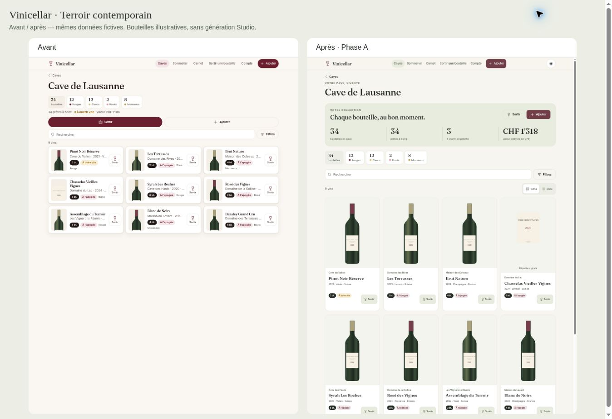
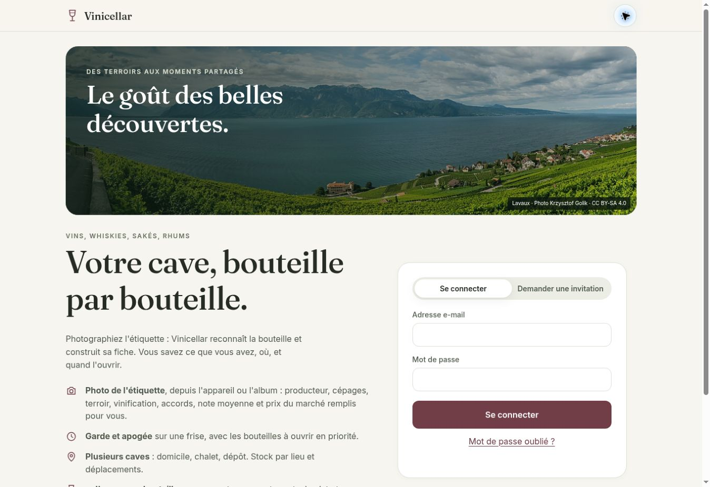

# Vinicellar 2 · Revue de la phase A

Branche : `feat/vinicellar-2-ui`. Référence de comparaison : `1bcfb4d`.

## Résultat

Le catalogue utilise une grille photographique à deux colonnes sur mobile et trois à cinq colonnes sur desktop, avec une vue liste alternative. Les bouteilles ne sont pas recadrées ; une étiquette reste présentée comme une étiquette. Le dashboard, les composants communs, les fiches et les surfaces d'accueil adoptent la palette Terroir contemporain. Les thèmes système, clair et sombre sont disponibles.

La photographie de Lavaux est une vraie photo de Krzysztof Golik sous CC BY-SA 4.0. Les crédits sont visibles et documentés. Aucun paysage ou visuel Studio n'a été généré.





## Architecture préservée

- Aucun framework, build ou dépendance de production ajouté.
- Aucun fichier de `supabase/`, aucune configuration de connexion et aucune politique RLS modifiés.
- Aucun appel IA payant lancé pour les essais.
- Aucune migration, fusion, activation ou publication en production.
- L'authentification, les API de stock et le modèle collections/membres/viewer restent ceux de l'application.

Les modifications HTML concernent principalement les références de cache, couleurs de navigateur et états de chargement. Les styles du nouveau catalogue sont isolés sous `.catalog` pour éviter de changer la disposition des listes d'envies et des autres listes existantes.

## Conservation des photos

- Remplacer une étiquette ou une bouteille conserve l'ancienne référence dans `photo_paths`, sans écraser le fichier.
- Retirer une photo de la galerie détache sa référence et conserve le fichier privé.
- Supprimer une fiche ou une analyse conserve également ses fichiers sources privés.
- Aucun original existant n'a été transformé ou déplacé durant ce développement.

Limite : les fichiers détachés ne disposent pas encore d'un registre de restauration. Ils restent dans le stockage et peuvent augmenter le volume utilisé. La phase B devra ajouter la traçabilité des sources ; aucune purge automatique ne doit être appliquée à ces fichiers.

## Vérifications effectuées

### Automatisées, sans réseau

`node --test tests/core.test.cjs` : **5 tests réussis**.

- Déduplication, expiration et séparation par bucket des URL signées.
- Priorité de la couverture choisie et distinction bouteille/étiquette/photo.
- Échappement du rendu et absence de mutation de la source.
- Permissions frontend owner/member/viewer après chargement de session simulé.
- Préférences de thème valides et valeur invalide.

Les 20 fichiers JavaScript de l'application et du service worker passent `node --check`. `git diff --check` passe également.

### Dans Chrome, avec données fictives

| Parcours | Résultat observé |
| --- | --- |
| Recherche `dezaley` | Trouve Dézaley Grand Cru |
| Filtres Suisse puis Lavaux | Catalogue réduit à trois fiches |
| Bascule grille/liste | Vue et état du bouton mis à jour |
| Sortie « Bue » | Stock fictif diminué de 34 à 33 ; dialogue de dégustation proposé |
| Fiche : ajustement +1 | Stock fictif augmenté de 5 à 6 |
| Déplacement | Dialogue et caves source/destination disponibles |
| Ajout manuel | Retour à la capture avec confirmation de l'enregistrement fictif |
| Remplacement d'étiquette avec fichier de test | Nouvelle étiquette et ancienne photo présentes dans la galerie ; aucune suppression de fichier autorisée par le client de test |
| Rôle viewer | Aucun bouton de sortie dans les cartes ; dashboard en lecture seule |
| Thème sombre | Variables et couleur effective du fond vérifiées, interface inspectée visuellement |

| Largeur de l'iframe de test | Colonnes | Débordement horizontal du document |
| --- | --- | --- |
| 320 px | 2 | Aucun |
| 390 px | 2 | Aucun |
| 768 px | 3 | Aucun |
| 1 280 px | 4 | Aucun |
| 1 536 px | 5 | Aucun |

Les iframes testent les vraies media queries à leur largeur propre, sans émuler un appareil physique. Un défaut de hauteur intrinsèque recadrait les images mobiles ; il a été corrigé avec un cadre à proportions fixes et une image contenue dans ce cadre.

## Limites et recette restante

- Les essais navigateur utilisent un client Supabase simulé. Ils ne constituent pas un test de bout en bout contre une base de test réelle.
- Connexion réelle, invitations par e-mail, analyse IA, imports/exports Excel, paiements éventuels et mises à jour de fonctions backend n'ont pas été exécutés. Aucun de leurs traitements n'a été remplacé.
- Safari/iOS, installation PWA sur appareil physique, comportement hors ligne réel et parcours complet au lecteur d'écran restent à vérifier avant publication.
- Le contraste des nouveaux textes de navigation et boutons sur fond sauge a été renforcé ; cela ne constitue pas une certification WCAG de toute l'application.
- Les images historiques conservent leur fond réel. Les bouteilles transparentes restaurées/reconstituées et leur approbation indépendante appartiennent à la phase B.
- Le risque préexistant d'enregistrement partiel entre fiche et stock reste à traiter avant de brancher la proposition Studio après ajout.

## Reproduire la revue

```sh
node --test tests/core.test.cjs
python3 scripts/preview-ui.py
python3 -m http.server 8000 --directory dist
```

Routes : `/review/compare.html`, `/review/mobile.html`, `/review/after/fiche.html?id=wine-3`, `/review/after/ajouter.html`, `/review/after/catalogue.html?loc=home&role=viewer`.

La génération de l'aperçu utilise uniquement les fichiers du dépôt et la référence Git de comparaison. Le client de test n'appelle pas Supabase ; les accès de données réseau sont bloqués par CSP. Ne pas utiliser cet aperçu comme configuration de production.

## Validation et retour arrière

La PR reste en brouillon pour validation de la direction visuelle. Une éventuelle fusion vers `main` peut déclencher GitHub Pages : ne pas fusionner sans autorisation explicite.

Avant fusion, le retour arrière consiste à laisser `main` inchangé. Après une publication ultérieure autorisée, revenir aux fichiers de la version précédente et renouveler le cache du service worker. Cette phase ne modifie pas le schéma SQL et ne nécessite pas de migration inverse. Les fichiers originaux conservés ne doivent pas être purgés.
