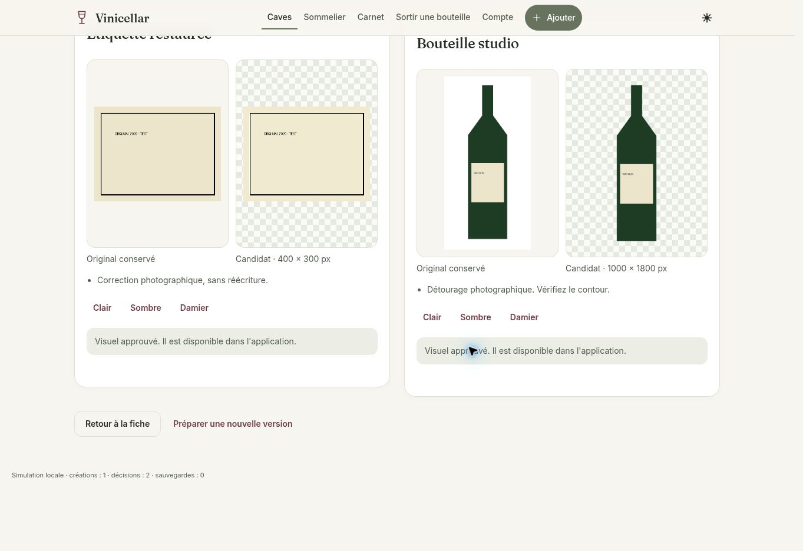
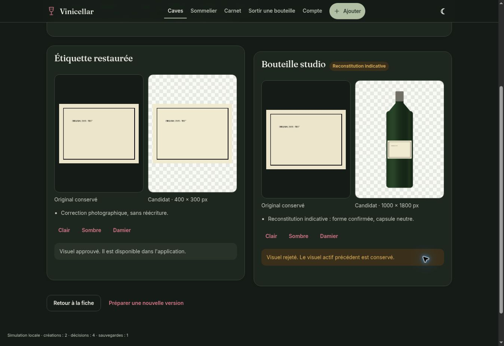

# Studio Vinicellar · phase B

Branche `feat/vinicellar-studio`, issue du `main` qui contient la phase A fusionnée. Implémentation destinée à la revue. **Aucun déploiement, aucune migration appliquée, aucune modification de données réelles, aucun service payant activé.** `studioEnabled` reste `false` dans la configuration livrée ; les fonctions et le worker ont également leur interrupteur serveur `STUDIO_ENABLED`.

## Parcours livré

1. Dans Ajouter, l'enregistrement Studio utilise une RPC transactionnelle et une clé de requête : fiche, stock, envies, retrait du brouillon et reçu sont validés ensemble. Une répétition de la même requête ne double pas le stock. Le parcours historique reste utilisé si Studio est désactivé.
2. Après succès, proposer « Créer les visuels Studio Vinicellar ? ». « Plus tard » ferme la proposition ; le lien ouvre la préparation sans lancer de traitement. Une fiche existante propose aussi « Ouvrir Studio ». La création manuelle depuis une liste d'envies propose également Studio après son enregistrement et son éventuel enrichissement.
3. Choisir indépendamment les sorties et leurs sources. Ajouter une photo conserve exactement le fichier fourni, sous un nouveau chemin privé. Formats JPEG/PNG/WebP, maximum 8 Mo ; aucune conversion silencieuse de l'original. Une photo HEIC doit être exportée avant import. Les anciens fichiers déjà réduits par l'application restent utilisables, sans possibilité de restaurer leurs pixels perdus.
4. Étiquette : indiquer quatre coins (haut gauche, haut droite, bas droite, bas gauche), ou confirmer une photo déjà recadrée. Bouteille : photo entière confirmée, fond uni ou contour guidé. Si la photo complète manque : forme et couleur explicitement confirmées avant composition indicative ; capsule neutre, aucun logo ou texte inventé.
5. « Lancer la création » est la confirmation qui crée le travail serveur. Afficher les étapes ; le traitement persiste après fermeture et se retrouve depuis la fiche. Une reconnexion relit le même travail ; une nouvelle version nécessite une action distincte.
6. Comparaison original/candidat, fonds clair/sombre/damier, approbation et rejet séparés. Les candidats restent privés et inactifs. Une approbation copie dans le bucket privé approuvé et active atomiquement la sortie correspondante ; un rejet garde l'ancien actif. Les décisions concurrentes incompatibles sont refusées. Rejouer une ancienne approbation ne réactive pas cette ancienne version.
7. Catalogue, fiche, listes d'envies, sortie et sommelier utilisent les actifs approuvés. Priorité : bouteille Studio, couverture choisie, bouteille historique, étiquette Studio, autres originaux. Les bouteilles composées portent « Reconstituée » jusque dans la grille et la liste. La galerie conserve les originaux et montre aussi l'étiquette restaurée indépendamment de la bouteille.

L'import de tableaux reste un parcours par lot ; chaque fiche importée donne accès au Studio. Il ne lance aucun traitement en masse.

## Traitement réellement implémenté

Moteur **photographique déterministe** Python/Pillow/NumPy, sans API d'IA, modèle à télécharger ou facture de génération. Perspective projective, recadrage, correction modérée du contraste et accentuation légère, sans OCR ni réécriture des textes, armoiries, logos ou millésimes. Détourage d'un fond simple par segmentation du fond connecté aux bords ; un fond complexe demande un contour. Une image avec alpha véritable peut réutiliser son masque. Bouteille recadrée par un bord : échec explicite. Les résultats doivent toujours être contrôlés visuellement, notamment les reflets et le verre transparent.

Le maître bouteille est un **PNG RGBA 1000 × 1800**, entier, centré, avec marges et alpha réel. Les petites sources sont agrandies pour harmoniser le cadrage ; cela ne recrée pas du détail absent. L'étiquette est limitée à 1600 px par côté. Une reconstitution utilise une forme générique, le verre confirmé et l'étiquette photographique ; elle ne prétend pas reproduire les caractéristiques inconnues du contenant. Le fichier et son enregistrement restent identifiés `bottle_reconstructed`. Aucun paysage n'est généré ou modifié par cette phase ; les photographies et crédits de Lavaux restent en place.

Ce moteur ne promet pas une restauration générative d'étiquette ni un détourage automatique universel. Ajouter ultérieurement un fournisseur IA demanderait une revue de conservation des caractères, de confidentialité et de coût, puis une autorisation distincte.

## Fichiers et responsabilités

| Fichier | Rôle |
| --- | --- |
| `assets/js/studio.js`, `studio-page.js`, `app/studio.html` | Préparation, sources, contours accessibles au clavier, suivi et comparaison |
| `assets/js/ajouter.js` | Sauvegarde transactionnelle optionnelle et proposition après succès |
| `assets/js/core.js`, `cave.js`, `fiche.js`, `envies.js`, `sortir.js`, `sommelier.js` | Chargement groupé des actifs approuvés, signatures privées, rendu et mentions |
| `assets/css/app.css`, pages `app/*.html`, `sw.js` | Composants responsives, module partagé et version de cache |
| `supabase/functions/studio-start`, `studio-review`, `_shared/studio-*` | JWT vérifié, permissions, empreinte des sources, démarrage et promotion |
| `supabase/proposals/studio.sql` | Proposition additive du schéma, buckets, RLS et RPC ; **non exécutée** |
| `studio-worker/processor.py`, `worker.py` | Traitement réel et consommation de la file ; aucun port HTTP entrant |
| `tests/studio.test.mjs`, `tests/core.test.cjs`, `studio-worker/test_processor.py` | Tests locaux sans base ni réseau Supabase |
| `scripts/preview-ui.py`, `tests/fixtures/browser-mock.js` | Aperçu isolé et données synthétiques, connexions Supabase bloquées par CSP |

## Schéma et permissions proposés

`studio_jobs` suit les sorties demandées, chemins et SHA-256 des originaux, réglages, empreinte, étapes, erreurs, tentatives et bail du worker. `studio_assets` suit chaque sortie, candidat, maître approuvé, dimensions, alpha, provenance, avertissements, décision, réviseur et état actif. Une seule sortie active par fiche/type. Les clés composites maintiennent la cohérence fiche/collection/travail.

Les membres en lecture seule voient les images approuvées ; seuls owner/member peuvent consulter les travaux et candidats de leurs collections ou décider. Le navigateur n'a aucun droit direct d'écriture sur ces deux tables ou buckets. Les RPC techniques sont réservées au rôle serveur et revérifient l'appartenance actuelle. Les RPC de sauvegarde et d'attachement sont `SECURITY INVOKER` : elles conservent les RLS existantes. Le reçu de sauvegarde est dans un schéma privé, avec RLS personnelle.

Les fonctions lisent les sources avec le **JWT de l'utilisateur**, uniquement parmi les chemins attachés à la fiche : le rôle serveur ne donne pas accès à une autre cave. Une photo d'un ancien membre peut rester utilisable si les permissions existantes autorisent sa lecture. Le worker vérifie le SHA-256 téléchargé ; l'approbation revérifie la source et le candidat, et la transaction vérifie que les sources sont encore rattachées. Aucune nouvelle règle n'est ajoutée au bucket historique `labels`.

Les deux nouveaux buckets sont privés et limités aux PNG de 8 Mo. Les URL signées Studio expirent après cinq minutes, leur cache frontend est renouvelé avant expiration. Comme toute URL signée, un lien déjà émis peut rester valable jusqu'à son expiration après révocation d'un accès. Les fichiers candidats ne sont jamais confondus avec les actifs approuvés.

## File, cache et reprise

Empreinte SHA-256 des octets sources + fiche + sorties + réglages normalisés + version de pipeline. Déduplication des travaux en vol par contrainte unique et verrou transactionnel. Réutilisation des résultats prêts ; une nouvelle version explicite peut contourner ce cache. Les quotas proposés sont 20 travaux/utilisateur et 100/collection sur 24 heures, sous verrous transactionnels.

Le worker réclame avec `FOR UPDATE SKIP LOCKED`, bail de cinq minutes, trois tentatives au maximum après interruption réseau. Les chemins candidats incluent le jeton du bail : un worker retardataire ne peut pas écraser le résultat d'un autre. Une sortie peut réussir quand l'autre échoue. La promotion copie sous un chemin immuable lié à l'asset ; seule la transaction de décision active le fichier. Un échec après la copie laisse au plus un fichier privé inactif, jamais une activation implicite.

Les originaux ne sont ni écrasés ni supprimés. Aucune purge automatique n'est incluse. Les fichiers détachés, candidats rejetés et copies orphelines peuvent consommer du stockage ; prévoir ultérieurement une politique de conservation autorisée et auditée, sans suppression des originaux. Les journaux du worker n'affichent ni photos, URL signées ni secrets.

## Validation locale

```sh
python3 -m pip install -r studio-worker/requirements.txt
node --test tests/*.test.cjs tests/*.test.mjs
python3 -m unittest discover -s studio-worker -p 'test_*.py' -v
python3 scripts/preview-ui.py
python3 -m http.server 8000 --directory dist
```

13 tests Node et 11 tests Python : confirmations, sources attachées, reconstitution explicite, cache canonique, feature désactivée sans accès aux tables, refus d'activer un candidat, signatures séparées et courtes, conservation des octets, perspective, contours, orientation EXIF et retrait des métadonnées des dérivés, transparence, marges, proportions, sources invalides ou modifiées, réussite partielle et reprise réseau du worker. La syntaxe JavaScript est également vérifiée, ainsi que les deux Edge Functions avec `deno check` (dépendances npm 2.57.4 installées dans un répertoire temporaire, sans démarrer les fonctions). Le SQL a été analysé statiquement avec `pglast` : 41 instructions ; les sept corps PL/pgSQL sont analysés en remplaçant seulement les types de lignes par `record` dans une copie temporaire, car le parseur hors base ne résout pas les types du projet. Cela ne constitue pas un test d'intégration Postgres/RLS.

Dans le navigateur isolé, vérification de l'ajout manuel → proposition sans génération automatique → import d'un original → création explicite → comparaison → approbation de l'étiquette/rejet de la bouteille → fiche/catalogue avec seulement le visuel approuvé. Second scénario : détourage, approbations successives et reprise depuis la fiche ; les deux originaux restent visibles. Vérifications responsive et sombre documentées avec les captures de revue. La file et les appels serveur de cet aperçu sont simulés ; les PNG de test sont produits par le vrai moteur local à partir de formes et textes synthétiques, **pas de photos de vins réels**.

- `/review/after/studio.html?id=wine-0` : préparer un traitement fictif.
- `/review/studio-width-320.html`, `studio-width-390.html`, `studio-width-768.html`, `studio-width-1280.html` : largeur imposée dans une iframe.
- Ajouter `&reset=1` une fois réinitialise les données fictives ; enlever ce paramètre avant de tester une reprise. `?role=viewer` sur la page Studio affiche un accès en lecture seule.
- `dist/` est ignoré, jamais un build de production. Les données de QA se conservent seulement dans la session locale du navigateur.

## Activation : décisions requises avant toute opération

Le fichier SQL reste volontairement dans `supabase/proposals/`, hors des migrations automatiquement applicables. Il doit être comparé au schéma réel et converti en migration versionnée après autorisation. Prérequis : `schema.sql`, partage, brouillons, listes d'envies, rôle viewer, photos et champ contre-étiquette déjà présents. Une transaction crée de nouvelles tables, index, règles, fonctions et deux buckets ; pas de suppression de tables/colonnes existantes. L'application d'une migration reste une modification de base nécessitant l'accord du propriétaire, même additive.

Ordre proposé, **non exécuté** :

1. Autoriser un environnement Supabase isolé et l'application de cette proposition sur cet environnement. Ne copier aucune photo privée de production sans décision distincte.
2. Vérifier les migrations et les tests d'intégration ci-dessous ; déployer `studio-start` et `studio-review` uniquement dans cet environnement. Garder la vérification JWT du gateway et la vérification `getUser()` dans les fonctions. Configurer `STUDIO_ENABLED=true` et `STUDIO_ORIGINS` avec les seules origines de test autorisées ; les clés restent dans les secrets serveur Supabase.
3. Choisir une machine contrôlée pour le worker. Python 3.12+, dépendances épinglées, compte système dédié, aucun endpoint public ; fournir `SUPABASE_URL` et `SUPABASE_SERVICE_ROLE_KEY` par l'environnement sécurisé, puis `STUDIO_ENABLED=true`. Ne pas mettre la clé dans une URL, un argument de commande, le frontend ou Git. La copie `.env.example` contient uniquement des valeurs vides/désactivées ; le programme ne charge pas automatiquement un `.env`.
4. Sur la machine autorisée, lancer `python3 studio-worker/worker.py` sous un superviseur. Pas de création de serveur ou d'abonnement payant incluse ; même le moteur local utilise des ressources et du stockage Supabase, à dimensionner avant activation.
5. Activer `studioEnabled:true` seulement sur le frontend de test. Tester avec comptes owner, member, viewer et extérieur. Revue visuelle sur des photographies réelles autorisées, de bouteilles claires, vertes, brunes et sur différents fonds.
6. Obtenir une autorisation distincte pour toute migration, modification de secrets, activation, hébergement payant et déploiement de production. Aucune fusion automatique de la PR.

Tests d'intégration bloquants avant activation réelle : accès anon refusé ; viewer incapable de démarrer, modifier ou décider ; isolement de deux collections pour tables et fichiers ; sources non rattachées refusées ; accès retiré entre démarrage/traitement/décision ; concurrence de deux workers et expiration des baux ; cache et quota concurrents ; rejeu de sauvegarde sans stock doublé, rollback si stock/envies échouent ; décisions concurrentes, copie interrompue et rejeu d'une ancienne approbation ; fichier réellement transparent sur les deux thèmes ; conservation des originaux. Ces tests n'ont pas été exécutés sur Supabase : cela demanderait l'autorisation de créer/appliquer le schéma.

Désactivation réversible prévue : arrêter le worker et mettre les deux interrupteurs à `false`. Ne supprimer aucune table ni aucun fichier ; les originaux et le parcours historique restent disponibles. Les travaux interrompus reprendront selon leur bail à une réactivation autorisée.

## Captures de revue (données synthétiques)

Contrôles réalisés à 320, 390, 768 et 1280 pixels, sans débordement horizontal observé ; formulaire testé à 320 px et comparaisons en clair/sombre. Le contrôle frontend d'un viewer affiche « Cette cave est partagée en lecture seule » sans lancer de traitement. Les contrôles backend/RLS réels restent à exécuter sur l'environnement autorisé.




